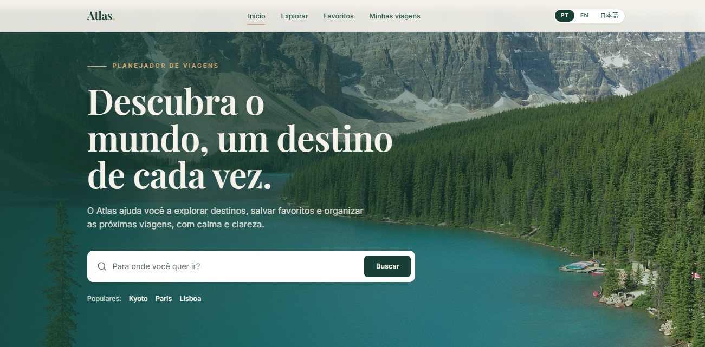
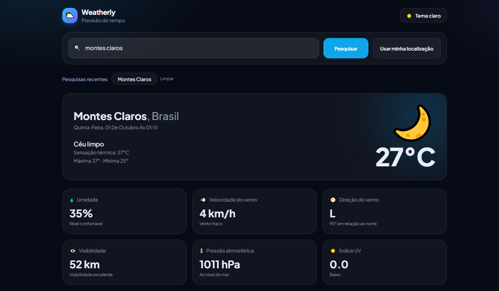
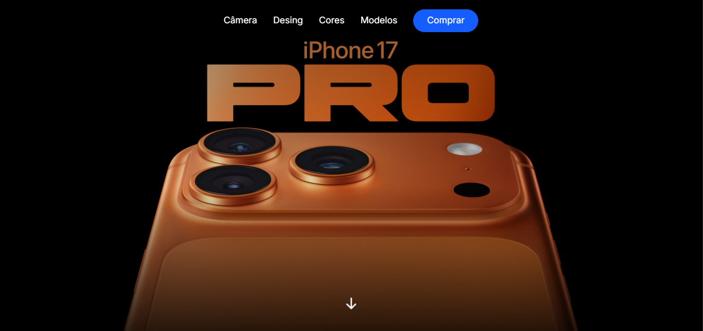
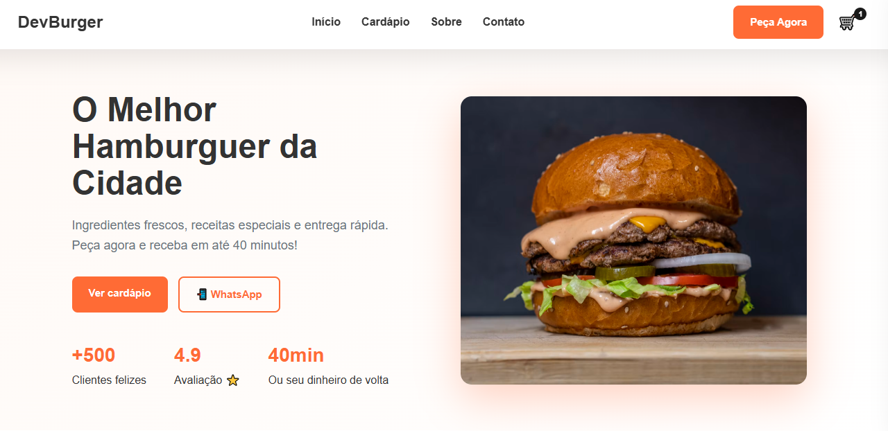

<!-- HEADER -->

  

---

## 👨‍💻 About Me

I'm a **Front-End Developer in training** passionate about building modern, responsive and user-friendly web interfaces.

I'm currently pursuing a **Technical Program in Systems Development at Proz Educação**, with expected completion in **December 2026**.

My experience includes building projects with **React, TypeScript, JavaScript, Tailwind CSS and APIs**, as well as exploring mobile development with React Native and Expo.

I enjoy turning ideas into functional digital experiences, focusing on visual consistency, reusable components, responsive layouts and code quality.

**Currently looking for my first Front-End internship or Junior Developer opportunity.**

 

---

## 🚀 Featured Projects

<table width="100%">
<tr>
<td width="50%" valign="top">

### 🌍 Atlas

**Travel Discovery Platform**

A modern travel discovery platform designed to explore destinations, discover new places, save favorite locations and organize upcoming trips through an intuitive experience.

**Stack:** React · TypeScript · React Leaflet · Open-Meteo · React Router

<a href="https://fabioalx29.github.io/Projeto-Atlas/">Live Demo →</a>

</td>
<td width="50%" valign="top">

### 🌦️ Weatherly

**Weather Dashboard**

A weather application powered by the Open-Meteo API, featuring city search, current weather conditions, hourly and 7-day forecasts, temperature charts and recent searches.

**Stack:** React · TypeScript · Tailwind CSS · API

<a href="https://fabioalx29.github.io/Projeto-Clima-/">Live Demo →</a>

</td>
</tr>

<tr>
<td width="50%" valign="top">

### 📱 iPhone 17 Pro

**Product Landing Page**

A responsive product landing page inspired by Apple's visual language, featuring reusable components, product specifications, smooth transitions and modern layouts.

**Stack:** React · Tailwind CSS · JavaScript

<a href="https://fabioalx29.github.io/Projeto-React-Tailwind/">Live Demo →</a>

</td>
<td width="50%" valign="top">

### 🍔 DevBurger

**Interactive Restaurant Website**

A responsive burger shop featuring a functional shopping cart, quantity management, dynamic price calculation and WhatsApp checkout integration.

**Stack:** React · Tailwind CSS · JavaScript

<a href="https://fabioalx29.github.io/Projeto-Hamburgueria/">Live Demo →</a>

</td>
</tr>

<tr>
<td width="50%" valign="top">

### 🐶 Pet Shop App

**Academic Mobile Application**

A mobile application developed during my Systems Development program, simulating a pet shop platform.

- Product catalog and search
- Shopping cart
- Responsible adoption form
- Donations form

**Stack:** React Native · Expo · JavaScript

<a href="https://fabioalx29.github.io/portfolio/">Portfolio & Project Demo →</a>

</td>
<td width="50%" valign="top">

</td>
</tr>
</table>

---

## 🛠️ Tech Stack

### Front-End Development

### Tools & Workflow

---

## 📚 Currently Improving

- React and TypeScript
- API integration and data handling
- Responsive design and accessibility
- Reusable components and component architecture
- React Native and mobile development
- Clean and maintainable code

---

## ⚡ Developer Activity

  

  

  

BUILDING DIGITAL EXPERIENCES · ONE COMMIT AT A TIME

---

## 🎯 My Focus

Building digital experiences that combine:

**Good Design** · **Responsive Interfaces** · **Reusable Components** · **Performance** · **Code Quality**

I believe every project is an opportunity to learn, improve and build something better.

---

## 🤝 Let's Connect

